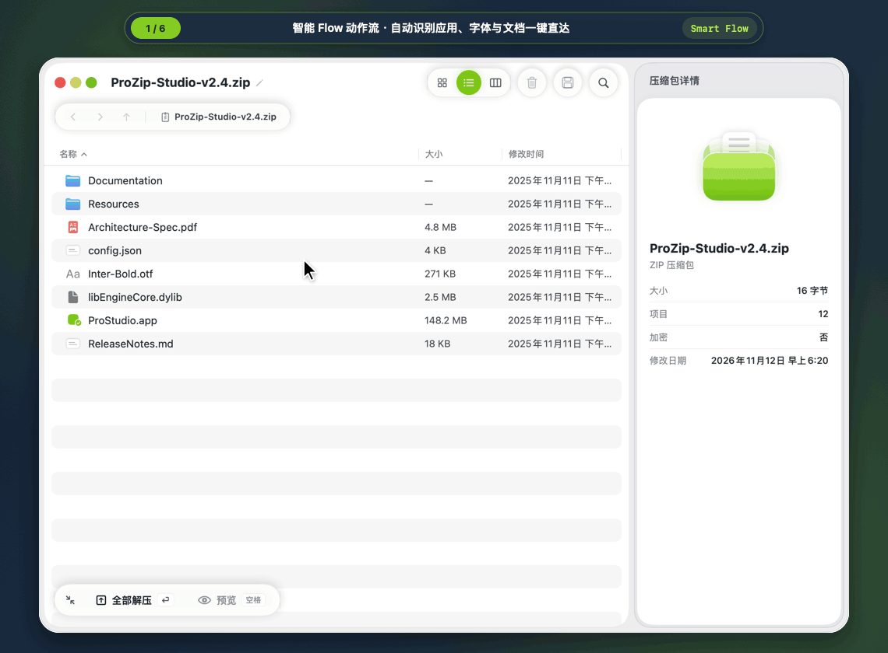

<p align="center">
  
</p>

<h1 align="center">ProZip</h1>

<p align="center">
  <strong>現代、優雅且高效能的 macOS 開源解壓縮與封存檔管理工具</strong><br>
  原生 Swift / SwiftUI 打造 · 四層引擎深度融合 · SQLite 極速索引 · 系統級延伸功能整合
</p>

<p align="center">
  <a href="../../README.md">English</a> ·
  <a href="../zh-CN/README.md">简体中文</a> ·
  <strong>繁體中文</strong> ·
  <a href="../ja/README.md">日本語</a> ·
  <a href="../ko/README.md">한국어</a> ·
  <a href="../es/README.md">Español</a> ·
  <a href="../fr/README.md">Français</a> ·
  <a href="../de/README.md">Deutsch</a> ·
  <a href="../ru/README.md">Русский</a>
</p>

<p align="center">
  <a href="https://github.com/scoltzero/prozip/stargazers"></a>
  <a href="https://github.com/scoltzero/prozip/forks"></a>
  <a href="https://github.com/scoltzero/prozip/releases"></a>
  <a href="https://github.com/scoltzero/prozip/releases/latest"></a>
  <a href="https://developer.apple.com/macos/"></a>
  <a href="../../LICENSE"></a>
</p>

<p align="center">
  <a href="https://github.com/scoltzero/prozip/releases/latest"></a>
  <a href="#快速開始"></a>
  <a href="https://github.com/scoltzero/prozip/issues"></a>
</p>

<p align="center">
  
</p>

> [!IMPORTANT]
> **關於本專案的定位與初衷**：
> 本專案為開發者個人出於對 macOS 現代化桌面應用程式架構、SwiftUI 與 AppKit 混合互動設計、跨引擎封存串流（Archive Streaming Pipeline）及潔淨室（Clean Room）工程實踐的學習、研究與技術探索而發起的完全開源專案。
>
> 本軟體僅供技術交流與學習使用，無意與市面上任何成熟的商業壓縮軟體構成競爭。所有程式碼均由個人獨立撰寫，不包含任何商業逆向原始碼或未授權素材，全量原始碼均遵循 [GNU General Public License v3.0](../../LICENSE) 授權公開。歡迎廣大 macOS 開發者與開源愛好者交流探討、指正與共同完善。

---

## 為什麼選擇 ProZip

| 核心特性 | 說明 |
|---|---|
| **原生效能與體驗** | 純 Swift / SwiftUI 打造，深度融合 macOS 原生外觀、液態玻璃光學質感、觸控回饋與視覺層級，輕快敏捷。 |
| **四層引擎深度協同** | 結合 `NativeZipEngine`（零拷貝直讀）、7-Zip（LZMA2 多執行緒）、系統 `libarchive` 與 `hdiutil` 磁碟掛載。 |
| **SQLite 雙表極速索引** | 載入壓縮檔即在本機建立階層式索引資料庫，數萬項目秒級展開、篩選與局部解壓，告別漫長解包等待。 |
| **雙模式彈性工作區** | 支援 `1040×740` 多欄全功能工作區與 `560×422` 霧面 Mini 瀏覽視窗無縫切換（快速鍵 `⌥⌘M`）。 |
| **智慧 Flow 動作流** | 依情境自動識別壓縮檔內容（應用程式、字型、文件等），智慧推薦「安裝到應用程式」、「安裝字型」或直接開啟。 |
| **選單列暫存盒 (ProZip 檔案盒)** | 常駐選單列的敏捷暫存工作區，支援拖放收集多處散落檔案、資料夾內嵌穿透瀏覽與批次一鍵壓縮。 |
| **安全密碼本與 Touch ID** | 本機 AES-GCM 密碼安全管理，支援系統鑰匙圈（Keychain）與 Touch ID 硬體解鎖保護，多組密碼自動輪詢比對。 |
| **系統級深度延伸功能** | 隨附 Finder 右鍵快顯選單延伸功能（`FinderSync`）與空白鍵 `Quick Look` 極速預覽外掛程式。 |

---

## 格式支援矩陣

| 類別 | 支援格式與能力 |
|---|---|
| **主流解壓縮與瀏覽** | ZIP, 7Z, RAR (v4 / v5 / 分割檔), TAR, GZ, TGZ, BZ2, TBZ2, XZ, TXZ, ZST, TZST, CPIO, CAB, ISO, DMG 等 |
| **建立壓縮檔** | ZIP（支援 Deflate 速度與壓縮比調節、AES-256 加密、分割壓縮）、7Z（LZMA2 高壓縮比、標頭加密、分割壓縮）、TAR |
| **原位編輯與儲存** | 支援對現有單卷壓縮檔直接新增、刪除、重新命名檔案並安全原子提交（具備發佈交易與回滾保護） |

---

## 平台與系統需求

- **作業系統**：macOS 14.0 (Sonoma) 及以上版本
- **處理器架構**：Apple Silicon（M 系列晶片）原生執行與 Intel（`x86_64`）相容
- **隱私與環境**：純本機離線運作，預設不開啟任何聯網追蹤、遙測或遠端統計

---

## 快速開始

### 1. 下載預編譯版本
前往 [Latest Release](https://github.com/scoltzero/prozip/releases/latest) 頁面下載 `ProZip-v0.1.5-macos.dmg` 或 `ProZip-v0.1.5-macos.zip`（版本變更記錄請參閱 [CHANGELOG.md](CHANGELOG.md)）。

### 2. 安裝與執行
1. 開啟 DMG 磁碟映像檔，將 `ProZip.app` 拖入 `Applications`（應用程式）資料夾。
2. 點兩下開啟 ProZip。若出現系統安全性提示，可前往「系統設定 → 隱私權與安全性」點擊「仍要開啟」。
3. 首次啟動時可依導覽精靈提示啟用 Finder 延伸功能與 Quick Look 預覽外掛程式。

---

## 架構與技術實作

ProZip 採用清晰的分層架構，將介面互動、業務狀態、工作階段索引與底層解壓縮引擎完全解耦：

```text
┌─────────────────────────────────────────────────────────────┐
│              ProZip App & Extensions Layer                  │
│   (WorkspaceWindowView / MiniWindowView / MenuBarShelf)     │
│   (ProZipFinderSync Extension / ProZipQuickLook Plugin)     │
└──────────────────────────────┬──────────────────────────────┘
                               │
┌──────────────────────────────▼──────────────────────────────┐
│                    ProZipUI & ViewModels                    │
│   - AppViewModel (工作階段驅動、狀態流轉、Flow 動作決策)    │
│   - ProZipTheme (原生風格、色彩層級、動畫回饋)              │
└──────────────────────────────┬──────────────────────────────┘
                               │
┌──────────────────────────────▼──────────────────────────────┐
│                    ProZipCore Engine Layer                  │
│   - ArchiveBrowsingSession (工作階段生命週期與安全暫存管理) │
│   - EntryIndex (SQLite 極速目錄與項目索引表)                │
│   - PasswordBook (AES-GCM + Keychain + Touch ID 密碼金庫)   │
│   - ManagedTemporaryArtifactRegistry (暫存產物生命週期治理) │
└──────────────────────────────┬──────────────────────────────┘
                               │
┌──────────────────────────────▼──────────────────────────────┐
│                   Archive Engine Broker                     │
│   ├─ NativeZipEngine   : 純 Swift 原生直讀與快速寫入        │
│   ├─ SevenZipEngine    : 7-Zip LZMA2 / AES / 廣格式子系統   │
│   ├─ LibarchiveEngine  : 系統 libarchive 相容串流引擎       │
│   └─ DiskImageEngine   : hdiutil 磁碟映像與掛載管理         │
└─────────────────────────────────────────────────────────────┘
```

---

## 本機編譯與開發

本專案使用標準 Swift Package Manager 管理相依套件，並提供自動化建置腳本：

### 前置需求
- macOS 14.0+，已安裝 Xcode 15+ 或 Command Line Tools
- 透過 Homebrew 安裝的 `7zz` 工具（用於封裝內建引擎子集）：
  ```bash
  brew install sevenzip
  ```

### 建置步驟
1. **複製程式碼儲存庫**：
   ```bash
   git clone https://github.com/scoltzero/prozip.git
   cd prozip
   ```

2. **編譯 Swift 核心模組**：
   ```bash
   swift build -c release
   ```

3. **封裝完整 macOS 應用程式產物**（含 Finder 延伸功能與 Quick Look）：
   ```bash
   bash scripts/build_app.sh release
   ```
   封裝完成後，產物位於 `build/ProZip.app`。

---

## 獨立實作與開源交流說明

<details>
<summary><strong>展開查看設計理念與著作權邊界說明</strong></summary>

1. **研發宗旨與學習初衷**：
   本專案的開發初衷在於探索 macOS 現代桌面 GUI 開發的極致體驗。我們在開發中研究了業界眾多優秀壓縮工具在互動設計、動畫節奏、多引擎排程與串流處理上的先進思路，並透過純 Swift / SwiftUI 進行了獨立設計與編碼實作。

2. **獨立撰寫與潔淨室原則**：
   本專案不包含任何商業專有軟體的反組譯原始碼、受保護資源或私有憑證。所有商業邏輯、資料結構、UI 視圖程式碼均從零撰寫，符合 Clean Room 軟體工程原則。

3. **友善交流與非競爭承諾**：
   開源此專案的目的是為了與社群中對 macOS 桌面開發、檔案系統串流處理、原生跨語言互操作感興趣的開發者互相交流與學習。我們充分尊重所有商業軟體開發者的智慧財產權與辛勤付出，本儲存庫不以取代任何商業軟體為目的。

</details>

---

## 來源與致謝

ProZip 的實作離不開開源社群優秀基礎設施與函式庫的支援，特此向以下開源專案與維護者致上誠摯感謝：

| 開源專案 | 用途與貢獻 | 開源授權 |
|---|---|---|
| [ZIPFoundation](https://github.com/weichsel/ZIPFoundation) | 原生 Swift ZIP 結構解析與串流讀寫基礎 | MIT |
| [7-Zip / p7zip](https://www.7-zip.org/) | 7z、LZMA2 演算法與多格式解壓引擎 | LGPL-2.1+ / unRAR License |
| [libarchive](https://www.libarchive.org/) | 多格式串流封存相容層 | BSD |
| [libdeflate](https://github.com/ebiggers/libdeflate) | 高效能 Deflate / zlib 解壓縮參考 | MIT |

---

## 支持與交流

如果你喜歡 ProZip，或者它在學習與日常使用中對你有所幫助：
- 歡迎在 GitHub 上點亮一顆 **Star** ⭐️ 支持專案！
- 發現 Bug 或有改進建議？歡迎隨時提交 [Issues](https://github.com/scoltzero/prozip/issues) 或 Pull Request！

---

## 授權條款

ProZip 核心程式碼基於 **[GNU General Public License v3.0](../../LICENSE)** (GPL-3.0) 授權開源。  
引用的第三方開源元件繼續遵循其各自的上游開源授權條款。
